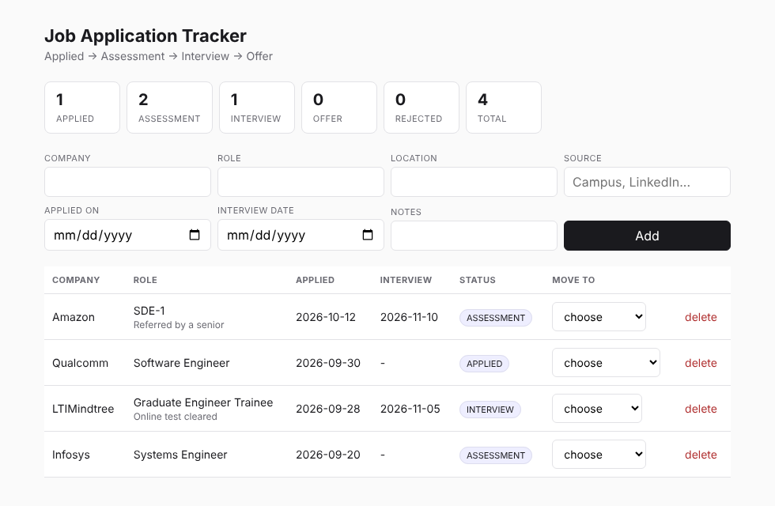

# Job Application Tracker

A REST API plus a small React page that track job applications through
**Applied -> Assessment -> Interview -> Offer** (with Rejected as an exit at any stage).

Stack: Java 21, Spring Boot 3.5, Spring Data JPA, PostgreSQL, React (Vite).



---

## Run the backend

**With PostgreSQL** (what the resume says, so use this one normally):

```bash
# once
createdb jobtracker          # or in psql:  CREATE DATABASE jobtracker;

cd backend
mvn spring-boot:run
```

The defaults expect Postgres user `postgres` with password `postgres`. If yours differ, set
`DB_USERNAME` and `DB_PASSWORD` as environment variables, or edit the defaults in
`src/main/resources/application.properties`. Hibernate creates the table on first start.

If you ran the older version of this project (the one with a status-history table) against
your local Postgres, drop and recreate the `jobtracker` database once. Its old tables do not
match this version.

**Without installing PostgreSQL** (useful when you just want to see it work):

```bash
cd backend
mvn spring-boot:run -Dspring-boot.run.profiles=h2
```

The API comes up on `http://localhost:8080`.

## Run the frontend

```bash
cd frontend
npm install
npm run dev
```

Opens on `http://localhost:5173`. Keep the backend running in another terminal.

## Try the API without the UI

Open `requests.http` in IntelliJ and click the arrows, or:

```bash
curl -X POST http://localhost:8080/api/applications \
  -H 'Content-Type: application/json' \
  -d '{"company":"LTIMindtree","role":"Graduate Engineer Trainee","appliedOn":"2026-10-04"}'

curl http://localhost:8080/api/applications
curl -X PATCH http://localhost:8080/api/applications/1/status \
  -H 'Content-Type: application/json' -d '{"status":"ASSESSMENT"}'
```

---

## Endpoints

| Method | Path | Does |
|---|---|---|
| POST | `/api/applications` | Add one. Always enters at APPLIED. |
| GET | `/api/applications` | List all, newest first. |
| GET | `/api/applications?status=INTERVIEW` | List one stage. |
| GET | `/api/applications/search?q=amazon` | Search company or role. |
| GET | `/api/applications/stats` | Count per stage plus total. |
| GET | `/api/applications/{id}` | One application. |
| PUT | `/api/applications/{id}` | Edit the details, including the interview date and notes. |
| PATCH | `/api/applications/{id}/status` | Move it one stage. |
| DELETE | `/api/applications/{id}` | Remove it. |

Status codes: `201` on create, `200` on read and update, `204` on delete,
`400` on a validation failure, `404` on a missing id, `409` on an illegal stage move.

## Layout

```
backend/src/main/java/com/ashutosh/jobtracker/
  JobTrackerApplication.java       starts Spring Boot
  entity/       JobApplication, ApplicationStatus                 -> the database table
  repository/   JobApplicationRepository                          -> the queries
  service/      JobApplicationService                             -> the rules
  controller/   JobApplicationController                          -> the HTTP layer
  dto/          request and response records                      -> what crosses the wire
  exception/    GlobalExceptionHandler and two exceptions         -> errors as clean JSON
backend/Dockerfile                                                -> how Render builds and runs it
frontend/src/App.jsx                                              -> the whole UI, one file
```

---

## Deployment

| Part | Host | Settings |
|---|---|---|
| Database | Neon (PostgreSQL) | Create a project. Copy the host, database name, user and password. |
| Backend | Render, Web Service, Docker | Root directory `backend`. Environment variables below. |
| Frontend | Vercel, Vite preset | Root directory `frontend`. Environment variable below. |

Render environment variables:

```
DB_URL       jdbc:postgresql://<neon-host>/<database>?sslmode=require
DB_USERNAME  <neon user>
DB_PASSWORD  <neon password>
```

Render sets `PORT` itself, and `application.properties` reads it.

Vercel environment variable (no trailing slash):

```
VITE_API_URL  https://<your-render-service>.onrender.com
```

The controller's `@CrossOrigin` already allows any `https://*.vercel.app` address.
On Render's free plan the backend sleeps after a period with no traffic, so the first
request after that takes about a minute.

---

Read `WALKTHROUGH.md` next. It explains why each of those folders exists and lists the
questions an interviewer will ask about this project.
